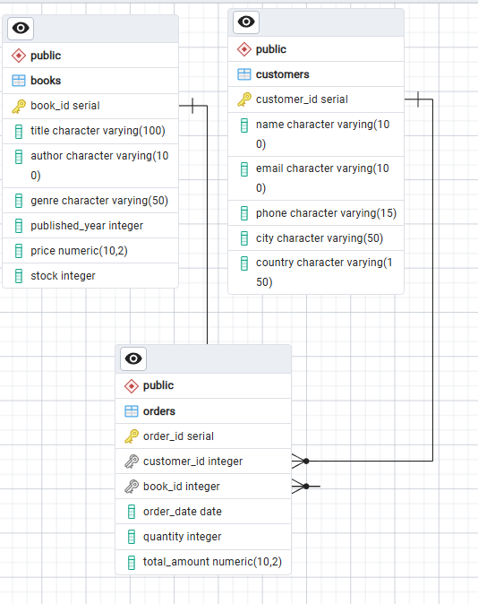

# 📚 Online Bookstore Analysis using SQL (PostgreSQL)

A beginner-friendly SQL project that analyzes an online bookstore's **books, customers, and orders** data. It covers creating a database, importing 3 CSV files, and answering 20 business questions using SQL, from simple filters to joins, aggregations, and inventory calculations.

---

## 🎯 Project Objective

To practice and demonstrate core SQL skills by answering real business questions such as:

- Which genres sell the most?
- Who are the top-spending customers?
- Which books are ordered most often?
- How much stock is left after fulfilling all orders?

---

## 🛠️ Tools & Technologies

| Tool | Purpose |
|------|---------|
| PostgreSQL | Database |
| pgAdmin 4 | Running queries & viewing results |
| CSV files | Source data (Books, Customers, Orders) |

---

## 📁 Files in This Repository

| File | What it is |
|------|------------|
| `README.md` | Project explanation (this file) |
| `bookstore sql project.sql` | Table creation, data import and all 20 queries |
| `Books.csv` | Catalog of books available in the store |
| `Customers.csv` | Customer details |
| `Orders.csv` | Orders placed by customers |

---

## 📂 Dataset

| File | Columns |
|------|---------|
| [`Books.csv`](Books.csv) | Book_ID, Title, Author, Genre, Published_Year, Price, Stock |
| [`Customers.csv`](Customers.csv) | Customer_ID, Name, Email, Phone, City, Country |
| [`Orders.csv`](Orders.csv) | Order_ID, Customer_ID, Book_ID, Order_Date, Quantity, Total_Amount |

---

## 🗂️ Database Structure

The database `OnlineBookstore` has 3 tables, one for each CSV file:

**Books**
| Column | Type |
|--------|------|
| Book_ID (PK) | SERIAL |
| Title | VARCHAR(100) |
| Author | VARCHAR(100) |
| Genre | VARCHAR(50) |
| Published_Year | INT |
| Price | NUMERIC(10,2) |
| Stock | INT |

**Customers**
| Column | Type |
|--------|------|
| Customer_ID (PK) | SERIAL |
| Name | VARCHAR(100) |
| Email | VARCHAR(100) |
| Phone | VARCHAR(15) |
| City | VARCHAR(50) |
| Country | VARCHAR(150) |

**Orders**
| Column | Type |
|--------|------|
| Order_ID (PK) | SERIAL |
| Customer_ID (FK → Customers) | INT |
| Book_ID (FK → Books) | INT |
| Order_Date | DATE |
| Quantity | INT |
| Total_Amount | NUMERIC(10,2) |

**How the tables connect:** each row in `Orders` points to one customer (`Customer_ID`) and one book (`Book_ID`).

### Entity Relationship Diagram


---

## 📸 Data Preview & Query Results

### Books Table Preview


### 1. Total books sold per genre


### 2. Customer who spent the most


### 3. Most frequently ordered book


### 4. Remaining stock after all orders


### 5. Total revenue


## ▶️ How to Run This Project

1. Install **PostgreSQL** and **pgAdmin**.
2. Download or clone this repository.
3. Create the database: `CREATE DATABASE OnlineBookstore;`
4. Run the `CREATE TABLE` statements from `bookstore sql project.sql`.
5. Import the 3 CSV files **in this order**: Books → Customers → Orders (Orders depends on the other two tables).

   **Option A: pgAdmin:** right-click the table → *Import/Export Data* → choose the CSV file → turn on *Header*.

   **Option B: SQL:** use `COPY` with the full path to the file on your computer:
   ```sql
   COPY Books(Book_ID, Title, Author, Genre, Published_Year, Price, Stock)
   FROM 'YOUR_PATH/Books.csv' CSV HEADER;

   COPY Customers(Customer_ID, Name, Email, Phone, City, Country)
   FROM 'YOUR_PATH/Customers.csv' CSV HEADER;

   COPY Orders(Order_ID, Customer_ID, Book_ID, Order_Date, Quantity, Total_Amount)
   FROM 'YOUR_PATH/Orders.csv' CSV HEADER;
   ```
6. Run the queries one by one and check the results.

---

## ❓ Business Questions Solved

### 🟢 Basic Queries
1. Retrieve all books in the "Fiction" genre
2. Find books published after 1950
3. List all customers from Canada
4. Show orders placed in November 2023
5. Retrieve the total stock of books available
6. Find the most expensive book
7. Show orders where quantity is more than 1
8. Retrieve orders where the total amount exceeds $20
9. List all genres available
10. Find the book with the lowest stock
11. Calculate total revenue from all orders

### 🔵 Advanced Queries
1. Total number of books sold per genre
2. Average price of "Fantasy" books
3. Customers who placed at least 2 orders
4. Most frequently ordered book
5. Top 3 most expensive "Fantasy" books
6. Total quantity sold by each author
7. Cities of customers who spent over $30
8. Customer who spent the most
9. Remaining stock after fulfilling all orders

---

## 💡 Sample Queries

**Total books sold per genre**
```sql
SELECT b.genre, SUM(o.quantity) AS total_sold
FROM Books b
JOIN Orders o ON o.book_id = b.book_id
GROUP BY b.genre;
```

**Customer who spent the most**
```sql
SELECT c.name, SUM(o.total_amount) AS total_spent
FROM Orders o
JOIN Customers c ON c.customer_id = o.customer_id
GROUP BY c.customer_id, c.name
ORDER BY total_spent DESC
LIMIT 1;
```

**Remaining stock after all orders**
```sql
SELECT b.book_id, b.title, b.stock,
       COALESCE(SUM(o.quantity), 0) AS ordered,
       b.stock - COALESCE(SUM(o.quantity), 0) AS remaining
FROM Books b
LEFT JOIN Orders o ON b.book_id = o.book_id
GROUP BY b.book_id
ORDER BY b.book_id;
```

---

## 📈 Key Insights


- Best-selling genre: **Romance**
- Top customer by spending: **Kim Turner**
- Most frequently ordered book: **Robust tangible hardware**
- Total revenue: **75628.66**

---

## 🧠 SQL Concepts Practiced

- `CREATE TABLE`, Primary Keys, Foreign Keys
- Importing CSV data with `COPY`
- `WHERE`, `BETWEEN`, `ORDER BY`, `LIMIT`, `DISTINCT`
- Aggregate functions: `SUM`, `AVG`, `COUNT`
- `GROUP BY` and `HAVING`
- `INNER JOIN` and `LEFT JOIN`
- `COALESCE` for handling NULL values
- Column aliases (`AS`)

---


## 👤 Author

**Baharul Islam**
- GitHub: [bahar906](https://github.com/bahar906/)
- LinkedIn: [baharul9096](https://www.linkedin.com/in/baharul9096/)

⭐ If you found this project helpful, feel free to star the repo!
